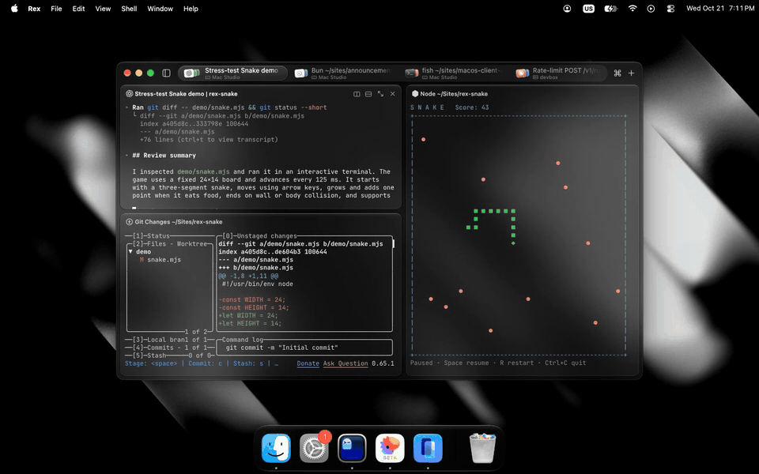

<a href="https://alanisavailable.com">
  
</a>

# Alan is available

I'm looking for my next role, so instead of a résumé I'm rebuilding the
products I'd love to work on, one at a time, right in the browser. Each one is
an interactive recreation of the real app, plus the bits I'd improve.

**Live at [alanisavailable.com](https://alanisavailable.com).** The code is
here so you can poke around and see how it's made.

## What's in it

| Product | What you get |
| --- | --- |
| [**Superlogical: Rex**](https://alanisavailable.com/superlogical) | A terminal workspace with tabs per device, split panes, a command palette and a playable Snake. There's also an iPhone version at [`/rex`](https://alanisavailable.com/rex) you can add to your Home Screen. |
| [**Claude Code**](https://alanisavailable.com/claude) | The Claude desktop app's Code tab: sidebar, streamed transcript, tool calls, diff, files, terminal and browser panels. |

Both run on a small macOS shell (menu bar, Dock, draggable windows, genie
minimize, full screen) shared by every desktop product.

## Run it

Needs Node 20.9+ and pnpm.

```bash
pnpm install
```

```bash
pnpm dev
```

Then open [localhost:3000](http://localhost:3000).

## How it's built

- [Next.js](https://nextjs.org) 16 (App Router, Cache Components), React 19
- Tailwind CSS 4 and [Motion](https://motion.dev) for animation
- MDX for each product page

```
src/
  app/            routes, metadata, OG image
  components/     homepage pieces (title, product cards)
  lib/            product loading, contact links
  os/macos/       the shared macOS shell: windows, Dock, menu bar
  products/<slug> one self-contained folder per product
public/
  os/macos/       wallpapers, Dock and menu bar assets
  products/<slug> each product's logo and assets
```

Every product is its own world, with its own components, styles, fonts and
assets, and nothing is shared between products except the macOS shell.
[src/products/README.md](src/products/README.md) covers the folder layout,
how to add a product and how to put an app on the macOS shell.

## Good places to start reading

- [src/os/macos/window.tsx](src/os/macos/window.tsx) and
  [window-manager.ts](src/os/macos/window-manager.ts): dragging, focus,
  minimize and full screen
- [src/os/macos/genie.tsx](src/os/macos/genie.tsx): the minimize-to-Dock effect
- [src/products/superlogical/components/rex/](src/products/superlogical/components/rex/):
  Rex's tabs, panes, command palette and the Snake game
- [src/products/claude/components/claude-code/](src/products/claude/components/claude-code/):
  the transcript, streaming and side panels

## Say hi

[X](https://x.com/stylessh) or [email](mailto:adaaanniel@gmail.com).

## Disclaimer

This is a personal portfolio project. I'm not affiliated with, endorsed by or
sponsored by any of the companies whose products appear here. Every product,
name, logo, icon, font, design and other asset belongs to its respective
owner, and all rights stay with them:

- **Rex** and **Superlogical** belong to Superlogical.
- **Claude**, **Claude Code** and **Anthropic** belong to Anthropic.
- **macOS**, **iPhone** and related Apple designs belong to Apple.

The recreations exist only to show my work. If you own one of these products
and want something changed or taken down, [email me](mailto:adaaanniel@gmail.com)
and I'll handle it.
